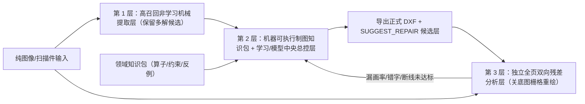

# Image-to-CAD 三层架构蓝图与防跑偏路线图

## 1. 核心定位与理论前提

本项目主攻**完全无矢量信息的纯图像／扫描件／照片 → 可编辑二维 CAD（DXF）**。原生矢量 PDF 解析仅作为附带直通工具保留，不得将矢量 PDF 转换结果冒充图像转 CAD 的核心进展。

工程制图与自然图像存在本质边界，这决定了任务在理论上可解：
- **制图逻辑层存在确定解**：工程图遵循明确制图语法（正交关系、跨交点共线贯通、离散标准线宽、封闭表框、字线分离、外框与内字组合）。同一交叉位置按制图逻辑只有一个合理解。
- **局部像素层天然多解**：打印、扫描与二值化会产生墨迹粘连、笔画模糊和交点块。局部几十个像素在纯粹的像素几何层面可以拆出多种拓扑走法。

历史实现长期卡死，根源在于同时犯了三处结构错误：
1. 阉割了“制图知识包”和“中央总控消歧层”，强迫底层像素规则在交点处独自证明局部唯一解；一旦存在分叉，底层算法要么报错弃画，要么不断叠加只针对单张裁片的硬规则特判。
2. 用文本框多边形整块涂白（切断穿行表框）和单字拆散，破坏对象完整性。
3. 把“独立分析层”缩水为仅检查“未画到白纸上”与“旧实体 ID 未变”，允许漏掉整页大半内容却返回通过。

---

## 2. 唯一合法的三层核心架构与可执行知识包

### 2.1 三层职责与强边界

| 层级 | 唯一输入 | 必须输出 | 严格禁止 |
| --- | --- | --- | --- |
| **第 1 层：高召回非学习机械提取层** | 原始图像（及可选透视/去阴影参数） | ① 颜色/形态分离的签章与 Logo 候选；② 中英文整行/段落 OCR 候选与紧凑字形连通域擦除掩膜；③ 单像素中心骨架「节点—边链」拓扑图、线宽估值及直线/圆/圆弧候选（含交叉口竞争多解） | 禁止在底层用苛刻角度/双引擎置信度硬门一刀切弃画；禁止整块涂白 OCR 矩形框切断表框与引线 |
| **第 2 层：机器可执行制图知识包 + 中央总控决策层** | 第 1 层全量候选、多解冲突区局部原图切片、知识包规则算子 | ① 确定对象组装为正式原生实体（`LINE`/`ARC`/`CIRCLE`/`LWPOLYLINE`/`TEXT`/`MTEXT`/`BLOCK`）；② 缺角或模糊断口生成带来源与不确定标记的可开关/可撤销实体写入 `SUGGEST_REPAIR` 层 | 禁止写“只读提示词合集”冒充知识包；禁止遇到不确定直接留白弃画；禁止无约束全页跨空白乱桥接 |
| **第 3 层：独立全页双向残差分析质检层** | 原始输入图像 + 实际保存并重新读取的 DXF（关闭所有参考底图与 `REVIEW_SOURCE`） | ① **正向漏画残差**（原图有墨迹但正式 CAD 缺失的比例与热区）；② **反向误画残差**（CAD 越框、文字重叠、切碎表线位置）；③ **可编辑性往返测试**（`TEXT`/`MTEXT` 改单字、非目标不变、签章透明独立） | 禁止与前两层共用内部状态；禁止开启残余墨迹图片遮羞渲染预览；禁止只用单测数量或旧 ID 保持替代全页验收 |

### 2.2 机器可执行制图知识包（最小可用算子清单）

知识包不是给大模型朗读的自然语言教材，而是直接被第 2 层调用的参数化规则与检验函数，优先落地以下六类确定性算子：
1. **跨交点共线贯通**：直线穿过数字、字母或斜短划时保持主线连续不断开。
2. **正交对齐与交点吸附**：近水平/垂直骨架边链按线宽容差正交化，并完成 T/L/X 端点吸附。
3. **表格与图签网格闭合**：识别成对行列边界，保持单元线连续不被内部文字擦除切碎。
4. **字线分离与单元格排版**：按行/单元格聚合文字，根据框内可用净空求解合理字高与宽度系数，严禁拆成单字 `TEXT`。
5. **复合工程符号成组**：将外框（圆/方框）、内部字符及邻接引线组装成独立可编辑的 `BLOCK` 或关联组，不遗失外框。
6. **标准线宽归一化**：根据距离变换中位直径映射标准 CAD 线宽档位（`0.13 / 0.25 / 0.50 / 1.00 mm`）。

---

## 3. 现存代码基座（`0.4.0-dev`）真实盘点与优先待办

主线已清出无关历史产物，当前 `cad_photo_to_dxf/app/` 保留了可复用的底层部件，同时存在**必须立即修正的 2 处代码暗雷**与**尚未建立的 3 块架构主干**。

### 3.1 当前保留的可用底层部件

- `app/geometry/scan_cleanup.py`：分块光照归一化、弱墨迹连通保留、Scanner 密集尘点与低对比度折痕抑制，以及软透明提取 `paper_ink_alpha`。
- `app/core/perspective.py`：纸张角点排序、置信度门限与透视校正。
- `app/geometry/scan_geometry.py`：Zhang-Suen 细化骨架、节点切分、最小二乘圆/圆弧与 SVD 直线拟合。
- `app/ocr/line_recognition.py`：基于离线 RapidOCR 的中英文整行识别与大图重叠分块去重。
- `app/ocr/signature_overlay.py`：独立于 OCR 的手写/签名形态检测。
- `app/export/product_fonts.py` & `app/core/font_install.py`：Noto CJK 与 `wqy-unicode.lff` 中文字体打包与本机注册。
- `app/core/pdf_conversion.py` & `tools/native_first/`：附带的矢量 PDF 原生路径提取工具。

### 3.2 优先修复的 2 处代码暗雷与 3 块缺失主干

1. **【暗雷 1 · 变相残余底图遮羞】** `app/core/scan_conversion.py` 当前将未拟合墨迹与低置信文字写入 `REVIEW_SOURCE` 图层的 `unresolved-ink.png`，且图层默认开启显示，`dxf_preview.py` 直接将其连同正常图元一起渲染。结果预览图看似完整，实则大量线条是无法编辑的位图。**必须将 `REVIEW_SOURCE` 设为默认关闭／冻结，默认预览图严格只渲染真实转换的 CAD 实体与受保护的签章/Logo。**
2. **【暗雷 2 · OCR 矩形涂白切碎表框】** `app/core/scan_conversion.py` 当前对识别出的每个 `line.quad` 多边形膨胀 3 像素后整块涂白（`fillConvexPoly`），再送入 `extract_scan_geometry`。只要文字贴近或压住表框线、引线，结构线就会被硬生生啃断。**必须改为只擦除框内属于字形的紧凑笔画连通域，同时保留长结构线与格线进入骨架提取。**
3. **【缺失主干 1】第 2 层机器可执行制图知识包算子库**：当前完全缺失（`scan_geometry.py` 仅做孤立边链拟合，未做交点贯通、正交对齐、表格闭合与复合符号组装）。
4. **【缺失主干 2】第 2 层学习/模型中央总控消歧层**：当前完全缺失（代码数为 0）。
5. **【缺失主干 3】第 3 层独立全页双向残差分析器**：当前完全缺失（`scan_conversion.py` 仅用内部 `coverage == 0` 导出残余图，没有关底图重渲染与原图双向比对质检）。

---

## 4. 历史七类跑偏与糊弄反例禁令

以下七类模式已在既往历史中反复导致项目失焦和返工，后续任何提交触发任一项均按路线跑偏处理：

| 反例类型 | 历史具体做法 | 硬性禁令 |
| --- | --- | --- |
| **1. 旁路发包** | 用 Base64 拼装源码跳过测试直接发布 Release | 禁止一切绕过仓库源码与测试门禁的构建脚本 |
| **2. 残余底图遮羞** | 整页 `SCAN_UNDERLAY` 垫图或默认显示 `unresolved-ink.png` 掩盖漏线 | 默认视图及预览严禁显示未转化残余位图；必须暴露真实漏画 |
| **3. 双边轮廓与碎字** | 用 `findContours` 把单线描成双边空心闭合圈；将词句拆成单字 `TEXT` | 线条必须提取中心线原生实体；正文必须输出完整词句 `TEXT`/`MTEXT` |
| **4. 虚假绿灯指标** | 在人眼可见严重错乱时，用自写宽松检查报出全部通过 | 严禁以单元测试数、文件大小或未关底图渲染替代全页残差与 CAD 实操验收 |
| **5. 影子架构空转** | 在主线旁新建十几层抽象目录并用单测禁止生产入口导入 | 新架构层必须直接跑通主入口 `app/core/conversion.py`，禁止隔离空转 |
| **6. 死账本绑定样图** | 把特定测试页线段 ID、坐标或节点列表写死进生产规则 JSON | 禁止按文件名、固定坐标、特定实体 ID 或局部裁片写死任何规则 |
| **7. 像素涂色与单图内卷** | 用 `HATCH` 涂黑像素格充当矢量化；围绕同一裁片几根短线建多代检查点包与合同文档 | 禁止 `HATCH` 像素拼贴；禁止恢复阶段检查点续算与微调子 Issue 内卷 |
